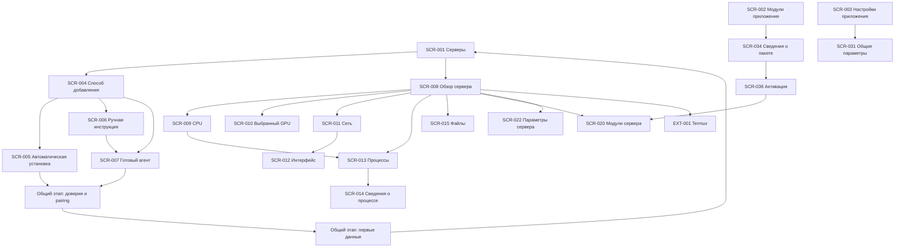

# Карта экранов и навигация ServerDeck

Актуализация интеграции 12 октября 2026 года: [дополнение клиентских контрактов](<Документация ServerDeck Agent/12. Согласование с клиентом.md>) задаёт действующие правила Agent для root/прав/модулей/корней/PURGE/localhost/истории/аудита и фоновой работы. Для этих границ прежние формулировки применяются с дополнением; макеты и старые обсуждения их не переопределяют.

## 1. Назначение и обозначения

Документ описывает логическую структуру мобильного приложения: самостоятельные экраны, мастера, диалоги, внешние переходы и связи между ними. Карта охватывает полный запланированный продукт.

Визуальный состав экранов уточняется в согласованных макетах Stitch и реализуется через общую тему и компоненты Jetpack Compose. Поведение, пользовательские цели, ошибки и результаты определяются функциональными требованиями и документом «5. Пользовательские сценарии».

Функциональные требования и требования безопасности задают поведение функций. Принятые пользователем изменения, ещё не перенесённые в требования, перечислены в документе сценариев; прежняя формулировка требования не отменяет такое согласованное решение. При обнаружении нового противоречия оно фиксируется явно.

### Типы объектов карты

| Обозначение | Назначение |
|---|---|
| SCR-xxx | Самостоятельный экран или мастер с отдельной пользовательской целью |
| DLG-xxx | Диалог или небольшая панель, открываемые поверх исходного контекста |
| EXT-xxx | Переход во внешнее приложение или системный интерфейс |
| Шаг мастера | Часть SCR-мастера; не получает отдельный SCR только из-за смены шага |
| Блок или состояние | Часть экрана: карточка, сводка, график, загрузка, пустой результат, сообщение об ошибке |

Идентификаторы постоянны и не зависят от порядка строк. Название и конкретный способ представления можно уточнять без смены ID, пока назначение объекта не меняется. Реестр задаёт логические назначения, а не обязательное число отдельных Compose-компонентов или назначений навигации. Клиент реализуется как нативное Android-приложение на Kotlin и Jetpack Compose.

Выбор нижней панели, вкладок, бокового меню и окончательная компоновка не определяются этой картой. «Ресурсы и диагностика» является группой переходов из обзора, а не дополнительным обязательным экраном.

## 2. Основные разделы приложения

### Уровень приложения

| Раздел | Начальный экран | Назначение |
|---|---|---|
| Серверы | SCR-001 | Стартовый экран, список сохранённых серверов и добавление подключения |
| Модули | SCR-002 | Установленные клиентские UI-пакеты, каталог, импорт и обслуживание пакетов |
| Настройки приложения | SCR-003 | Общие параметры, оформление, локальная защита, кэш и настройки переноса |

Переключение этих разделов доступно из их начальных экранов. Оно не должно незаметно отменять изменяющую операцию или закрывать форму с несохранённым вводом; выход из таких представлений обрабатывается правилами соответствующего сценария.

### Уровень выбранного сервера

Точкой входа является SCR-008 «Обзор сервера». Из него открываются CPU, выбранный GPU, сеть, процессы, файлы, модули этого сервера, параметры и запуск Termux. Действия редактирования, удаления и запуска SSH также доступны из карточки сервера согласно требованиям; обзор не является обязательным промежуточным шагом для них.

В обзоре предусмотрены Docker-сводка и сведения о безопасности в пределах FR-003.19–FR-003.27. Самостоятельные страницы управления Docker или изменения серверной политики безопасности этим документом не добавляются.

### Два уровня работы с модулями

- В SCR-002 управляются локально установленными клиентскими пакетами и их версиями.
- В SCR-020 управляются активацией и доступностью модулей для выбранного сервера.
- Установка клиентского пакета не активирует его автоматически, не устанавливает серверный модуль и не устанавливает стороннюю утилиту.
- Отключение модуля для сервера и удаление клиентского пакета имеют разные последствия и разные подтверждения.

## 3. Реестр экранов

UC-001–UC-009 уже описаны в документе сценариев. Отметка «UC предстоит» означает, что возможность предусмотрена требованиями и картой, но её подробный пользовательский сценарий ещё нужно написать. Это не ограничение состава продукта.

### Общие экраны и подключение

| ID | Название | Область и назначение | Основание |
|---|---|---|---|
| SCR-001 | Серверы | Приложение: список, сводка и переход к серверу | UC-002, UC-007; FR-001 |
| SCR-002 | Модули приложения | Приложение: установленные UI-пакеты и вход в каталог | FR-009, FR-010.7; UC предстоит |
| SCR-003 | Настройки приложения | Приложение: точки входа в категории настроек | FR-010; UC предстоит |
| SCR-004 | Выбор способа добавления | Вход в автоматическую установку, ручную инструкцию или подключение к готовому агенту | FR-002.7, FR-002.15; UC-001 и UC предстоит |
| SCR-005 | Автоматическая установка | Мастер SSH-подключения, установки, pairing и первых данных | UC-001; FR-002.1–FR-002.14, FR-002.16 |
| SCR-006 | Ручная установка | Инструкция установки и переход к подключению готового агента | FR-002.15; UC предстоит |
| SCR-007 | Подключение к готовому агенту | Мастер параметров агента, проверки доверия, pairing и первых данных | FR-002.16; UC предстоит |

### Просмотр выбранного сервера

| ID | Название | Область и назначение | Основание |
|---|---|---|---|
| SCR-008 | Обзор сервера | Сервер: общая картина и переходы к диагностике | UC-003; FR-003 |
| SCR-009 | CPU | Сервер: текущие показатели и история CPU | UC-004; FR-005 |
| SCR-010 | Выбранный GPU | Сервер и GPU: показатели, история и связанные процессы | FR-004; UC предстоит |
| SCR-011 | Сеть | Сервер: сетевая сводка и список интерфейсов | UC-005; FR-003.16–FR-003.18 |
| SCR-012 | Сетевой интерфейс | Сервер и интерфейс: показатели, история, задержка и потери | UC-005; FR-006 |
| SCR-013 | Процессы | Сервер: поиск, сортировка и дозагрузка процессов | UC-006; FR-008.1–FR-008.13 |
| SCR-014 | Сведения о процессе | Сервер и процесс: доступные сведения выбранного объекта | UC-006; FR-008.3–FR-008.9, FR-008.13 |

### Файлы выбранного сервера

| ID | Название | Область и назначение | Основание |
|---|---|---|---|
| SCR-015 | Файлы: доступные корни | Сервер: разрешённые корни с контекстом файловых систем | FR-007.1–FR-007.2; UC предстоит |
| SCR-016 | Каталог | Сервер, корень и путь: просмотр содержимого; повторное использование для дочерних каталогов | FR-007.3–FR-007.5; UC предстоит |
| SCR-017 | Просмотр текстового файла | Сервер и файл: полный или частичный просмотр | FR-007.7–FR-007.9; UC предстоит |
| SCR-018 | Редактирование файла | Сервер и файл: редактирование и сохранение с проверкой версии | FR-007.10–FR-007.12; UC предстоит |
| SCR-019 | Корзина | Сервер и разрешённая область: восстановление и окончательное удаление при поддержке | FR-007.19–FR-007.21; UC предстоит |

### Модули и параметры выбранного сервера

| ID | Название | Область и назначение | Основание |
|---|---|---|---|
| SCR-020 | Модули сервера | Сервер: активные и доступные для активации модули | FR-009.6, FR-009.9–FR-009.10; UC предстоит |
| SCR-021 | Страница модуля | Сервер, module_id и страница: декларативный интерфейс установленного пакета | FR-009.1–FR-009.5; UC предстоит |
| SCR-022 | Параметры сервера | Сервер: точки входа в подключение, переопределения, устройства и обслуживание | FR-002.17–FR-002.24, FR-010.1 |
| SCR-023 | Редактирование сервера | Сервер: метаданные и несекретные параметры подключения | UC-008; FR-002.17–FR-002.19 |
| SCR-024 | Переопределения настроек | Сервер: интервалы, таймауты и пороги относительно глобальных значений | FR-010.1–FR-010.4; UC предстоит |
| SCR-025 | Подключённые устройства | Сервер: устройства и отзыв выбранного доступа | FR-002.21, NFR-SEC-007; UC предстоит |
| SCR-026 | Обслуживание агента | Сервер: вход в мастера обновления или удаления агента | FR-002.20, FR-002.24; UC предстоит |
| SCR-027 | Восстановление подключения | Сервер: проверка доступа и доверия, повторная настройка или новый pairing | FR-002.19; UC предстоит |

SCR-026 и SCR-027 объединяют связанные процедуры на уровне карты. Их шаги и условия продолжения уточняются отдельными сценариями. Они не разрешают автоматическую установку, понижение версии или смену доверия.

### Настройки приложения и обслуживание пакетов

| ID | Название | Область и назначение | Основание |
|---|---|---|---|
| SCR-028 | Оформление и отображение | Приложение: тема, язык, единицы и формат времени | FR-010.5; UC предстоит |
| SCR-029 | Локальная защита | Приложение: биометрия и защита выбранных действий | FR-010.6; UC предстоит |
| SCR-030 | Локальное хранение | Приложение: объём, лимит и очистка кэша | FR-010.8; UC предстоит |
| SCR-031 | Общие параметры мониторинга | Приложение: глобальные интервалы, таймауты и пороги | FR-010.1–FR-010.4; UC предстоит |
| SCR-032 | Перенос настроек | Приложение: перенос несекретных настроек; конкретный способ ещё требует согласования | FR-010.9; UC предстоит |
| SCR-033 | Каталог модулей | Приложение: поиск и выбор клиентских пакетов | FR-009.12; UC предстоит |
| SCR-034 | Сведения о пакете | Приложение и пакет: описание, совместимость и доступные операции; используется для установленного пакета и каталога | FR-009.9, FR-009.12–FR-009.13; UC предстоит |
| SCR-035 | Установка, обновление или откат пакета | Мастер проверки пакета, совместимости и разрешений; операция определяется входом | FR-009.8–FR-009.9, FR-009.13; UC предстоит |
| SCR-036 | Активация для серверов | Приложение, пакет и выбранные серверы: явная активация с выдачей разрешений | FR-009.6, FR-009.9; UC предстоит |
| SCR-037 | Разрешения модуля на сервере | Сервер и модуль: просмотр и изменение выданных разрешений | FR-009.6; UC предстоит |
| SCR-038 | Подготовка Termux | Приложение с сохранённым контекстом сервера: инструкция готовности интеграции | FR-011.2; UC предстоит |

### Диалоги и внешние переходы

Перечень фиксирует назначения и места вызова. Поля, тексты и визуальные варианты относятся к спецификациям экранов и общим правилам UX.

| ID | Назначение | Исходный контекст |
|---|---|---|
| DLG-001 | Сортировка серверов | SCR-001 |
| DLG-002 | Удаление записи сервера и выбор дополнительных последствий | SCR-001, SCR-022, SCR-023; UC-009 |
| DLG-003 | Подтверждение TERM или KILL | SCR-013, SCR-014; FR-008.14 |
| DLG-004 | Подтверждение SSH-ключа | SCR-005, SCR-026, SCR-027 |
| DLG-005 | Подтверждение TLS-отпечатка при ручном подключении | SCR-007, SCR-027; автоматическая установка использует проверку по SSH |
| DLG-006 | Закрытие мастера после начала изменяющей операции или pairing | SCR-005, SCR-007, SCR-026, SCR-027 |
| DLG-007 | Создание, переименование или другие небольшие файловые формы | SCR-016; состав вариантов уточняется сценариями |
| DLG-008 | Подтверждение удаления, восстановления или окончательного удаления файла | SCR-016, SCR-017, SCR-019 |
| DLG-009 | Конфликт редактирования файла | SCR-018 |
| DLG-010 | Поиск и сортировка процессов: дополнительные параметры | SCR-013; строка поиска может оставаться частью экрана |
| DLG-011 | Цель проверки задержки и потерь | SCR-012 |
| DLG-012 | Метаданные файла или каталога | SCR-016, SCR-017 |
| DLG-013 | Подтверждение отзыва доступа устройства | SCR-025 |
| DLG-014 | Удаление клиентского пакета или отключение модуля | SCR-034 или SCR-020; последствия различаются |
| DLG-015 | Подтверждение разрешений пакета для выбранного сервера | SCR-035, SCR-036, SCR-037 |
| EXT-001 | SSH-сессия в Termux | Карточка или обзор сервера, либо повторный запуск из SCR-038 |
| EXT-002 | Системный выбор или сохранение файла | SSH-ключ, импорт UI-пакета, загрузка или скачивание файла |
| EXT-003 | Системная локальная аутентификация | Вход и действия, защищённые настройками |

DLG-007 и DLG-008 обозначают семейства однотипных представлений, а не универсальную операцию с неясными последствиями. Конкретное действие всегда явно называется. Сложный выбор пути может использовать SCR-016 в режиме выбора разрешённого назначения с возвратом к вызвавшему действию.

## 4. Карта переходов

### Основная схема



Pairing и первые данные на схеме — общие этапы SCR-005 и SCR-007, а не самостоятельные глобальные экраны. Общая реализация этапа не смешивает настройки двух разных мастеров. Переход к SCR-001 после получения первых данных обозначает успешное завершение; ошибки и закрытие определены соответствующим UC.

### Подключение и обслуживание агента

| Откуда | Действие или условие | Куда и с каким результатом |
|---|---|---|
| SCR-001 | Добавить сервер | SCR-004 |
| SCR-004 | Автоматическая установка | SCR-005 |
| SCR-004 | Установить вручную | SCR-006 → SCR-007 после установки |
| SCR-004 | Агент уже установлен | SCR-007 |
| SCR-005 | Обнаружен совместимый агент | Пропуск установки и переход к этапам доверия и pairing в текущем мастере по UC-001 |
| SCR-005 | Нужна другая версия агента | Отдельное подтверждение допустимого обновления; автоматического понижения нет |
| SCR-005 или SCR-007 | Pairing выполнен, первые данные не получены | Повторение получения данных на текущем этапе без новой установки и pairing |
| SCR-005 или SCR-007 | Получен первый корректный снимок | SCR-001 с добавленной записью |
| SCR-022 | Редактирование / переопределения / устройства / обслуживание | SCR-023 / SCR-024 / SCR-025 / SCR-026 с тем же сервером |
| Ошибка доступа в разделе сервера | Пользователь выбирает восстановление | SCR-027 с контекстом сервера и причиной ошибки |
| SCR-027 | Успешное восстановление | Возврат к вызвавшему разделу; если объект больше недоступен — к SCR-008 |
| DLG-002 | Удалить только запись | UC-009 → SCR-001 |
| DLG-002 | Также удалить агент | SCR-026, процедура удаления с отдельными последствиями и подтверждением |

Обратный переход из восстановления не означает успешную загрузку исходных данных: исходный раздел заново проверяет их доступность. Отзыв текущего устройства в SCR-025 не удаляет локальную запись автоматически; она становится требующей восстановления доступа согласно общим правилам.

### Диагностика и связанные объекты

| Откуда | Действие | Куда и какой контекст сохраняется |
|---|---|---|
| Карточка или обзор | Открыть предупреждение CPU | SCR-009 того же сервера |
| Блок GPU обзора | Выбрать GPU | SCR-010 с идентификатором конкретного устройства |
| SCR-008 | Открыть сеть | SCR-011 |
| SCR-011 или предупреждение | Выбрать интерфейс | SCR-012 с идентичностью интерфейса |
| SCR-012 | Настроить цель проверки | DLG-011 → возврат к тому же интерфейсу |
| SCR-009 | Открыть процессы | SCR-013 с сортировкой по CPU |
| SCR-010 | Открыть связанный процесс | SCR-014 при подтверждённой идентичности; если процесс завершился — пояснение без подстановки другого процесса |
| SCR-013 | Открыть процесс | SCR-014 того же сервера и объекта снимка |
| SCR-013 или SCR-014 | Завершить процесс | DLG-003 → результат на исходном экране |

Переход по имени контейнера, systemd unit или другой связи не создаёт автоматически полноценный экран управления этой сущностью. Если соответствующий раздел или модуль не определён, связь остаётся сведением, а не обещанием доступного перехода.

### Файловый менеджер

```text
SCR-015 Разрешённые корни с контекстом файловых систем
└── SCR-016 Каталог выбранного корня
    ├── SCR-016 Дочерний каталог
    ├── DLG-012 Сведения об объекте
    ├── SCR-017 Просмотр текстового файла
    │   └── SCR-018 Редактирование
    │       └── DLG-009 Конфликт сохранения
    └── DLG-007 / DLG-008 Файловые действия

SCR-015 или SCR-016 → SCR-019 Корзина при поддержке
SCR-019 → восстановление или окончательное удаление с подтверждением
```

- Навигация начинается с разрешённых корней; метрики файловой системы сами по себе не предоставляют доступ ко всему её содержимому.
- Дочерние каталоги используют тот же тип экрана с другим путём. Выбор назначения для перемещения или восстановления возвращает результат вызвавшему действию, не меняя его исходный объект.
- Переход к родительскому каталогу ограничен выбранным разрешённым корнем. Он не подменяет системную историю «Назад».
- После файлового действия обновляется соответствующий каталог. Изменение пути или имени не должно незаметно перенаправлять открытый редактор на другой файл.
- После успешного сохранения редактор возвращается к просмотру того же файла либо остаётся в режиме редактирования согласно будущей спецификации; точное поведение ещё нужно согласовать.
- Отмена разрешения конфликта не должна уничтожать введённый текст. Отдельные сценарии файлов уточнят выход из редактора с несохранёнными изменениями.

### Модули

```text
SCR-002 Модули приложения
├── SCR-034 Сведения об установленном пакете
│   ├── SCR-035 Обновление или откат
│   ├── DLG-014 Удаление клиентского пакета
│   └── SCR-036 Выбор серверов и активация
├── SCR-033 Каталог
│   └── SCR-034 Сведения о доступном пакете
│       └── SCR-035 Проверка и установка
└── EXT-002 Импорт файла → SCR-035

SCR-008 Обзор сервера
└── SCR-020 Модули сервера
    ├── SCR-036 Активация с уже выбранным сервером
    ├── SCR-037 Разрешения конкретного модуля
    └── SCR-021 Страницы активного модуля
```

- Сведения об установленном и доступном пакете используют один логический экран SCR-034 с разными доступными действиями.
- Переход из сервера к установке сохраняет исходный сервер. После успешной установки пользователь возвращается к явной активации для него, а не теряет контекст в общем каталоге.
- Из общего раздела модулей SCR-036 позволяет выбрать серверы. Из раздела конкретного сервера он получает этот сервер как исходный выбор; выдача разрешений остаётся явной для каждого сервера.
- После активации одного сервера открывается его SCR-020. После активации нескольких серверов результат показывается в контексте вызвавшего общего раздела без произвольного выбора одного сервера.
- Страницы модулей определяются локально установленным проверенным пакетом. Контекст включает сервер, module_id и страницу. Пакет не может подменить встроенный мастер подключения или подтверждение опасного действия.
- Отсутствующий клиентский пакет ведёт к его проверке и установке. Отсутствующий серверный модуль показывается как отдельное ограничение с инструкцией; локальная установка пакета его не устраняет автоматически.
- Если модуль отключён или удалён во время просмотра, его недействующая страница закрывается с пояснением и возвратом в SCR-020. Другой модуль автоматически не подставляется.

### Настройки приложения и внешние переходы

| Откуда | Действие | Куда |
|---|---|---|
| SCR-003 | Оформление / защита / хранение / общие параметры / перенос | SCR-028 / SCR-029 / SCR-030 / SCR-031 / SCR-032 |
| SCR-003 | Управление пакетами | Тот же SCR-002, без отдельной копии управления |
| SCR-001 или SCR-008 | Открыть SSH | Локальное подтверждение по настройкам → проверка готовности → EXT-001 |
| Запуск SSH | Termux не готов | SCR-038 → повторная проверка готовности → EXT-001 |
| Форма с выбором файла | Выбрать ключ, пакет или файл | EXT-002 → возврат в исходную форму с выбранным файлом либо без изменения при отмене |
| Защищённое действие | Пройти локальную проверку | EXT-003 → продолжение исходного действия только после успеха |

## 5. Правила навигации

### Контекст и возврат

1. Обычный запуск ведёт к SCR-001 после локальной разблокировки, если она включена. Выбор другого начального экрана не добавляется без отдельного решения.
2. Каждый экран сервера получает явный контекст сервера; экраны GPU, интерфейса, процесса и файла также получают идентичность объекта. При ошибке другой сервер или объект не подставляется автоматически.
3. Системное «Назад» возвращает по фактическому пути входа. Из процессов, открытых через CPU, пользователь возвращается к CPU. Из процесса, открытого через GPU, — к GPU.
4. Переход «к обзору сервера» и «Назад» имеют разное назначение. Если интерфейс предоставляет оба, их подписи и действия должны быть однозначными.
5. Возврат сохраняет поиск, сортировку, период и положение просмотра в пределах правил соответствующего UC. Если объект исчез или структура изменилась, приложение объясняет это и выбирает существующий родительский раздел.
6. Вложенный диалог закрывается раньше исходного экрана. Выход из формы или мастера с последствиями использует отдельное подтверждение, если оно предусмотрено сценарием.
7. После удаления текущей записи закрываются её представления и выполняется переход к SCR-001. Ответ старого запроса не восстанавливает запись.
8. Отсутствие сети само по себе не запрещает открытие обзора или доступных локальных сведений. Неподдерживаемая возможность и отсутствие права имеют собственное объяснение; они не ведут автоматически на экран добавления.

### Формы, мастера и внешние приложения

- До начала установки возврат на предыдущий шаг мастера сохраняет ввод только внутри открытого мастера. Закрытие всего незавершённого мастера очищает ввод без сохранения черновика.
- После начала изменяющей операции или успешного pairing закрытие учитывает уже выполненные действия. Оно не обещает откат; правила очистки локальных данных и отзыва токена задаёт UC-001 и будущие сценарии соответствующих мастеров.
- В SCR-023 отмена удаляет несохранённые изменения, сохраняя прежнюю рабочую конфигурацию по UC-008. Нельзя автоматически применить результат проверки после закрытия формы.
- Системный выбор файла и локальная аутентификация являются временными внешними представлениями, а не закрытием исходной формы. Их отмена не запускает действие и возвращает в тот же контекст.
- При запуске Termux ServerDeck передаёт только разрешённые параметры. SSH-сессия, её вывод, история команд и секреты обслуживаются Termux. ServerDeck не показывает выдуманное состояние подключения внешней сессии.
- Возврат из Termux сохраняет существующий контекст ServerDeck и обновляет данные по обычным правилам. Закрытие ServerDeck не означает завершение SSH-сессии в Termux.
- Возврат из внешнего приложения не гарантируется при завершении процесса ServerDeck операционной системой. В таком случае действует обычный запуск без восстановления незавершённой формы и SSH-секретов.

## 6. Нерешённые вопросы и связанные работы

| Вопрос | Текущее решение или необходимое уточнение |
|---|---|
| Отдельные страницы RAM и дисков | Пока не утверждены. Сводные данные остаются в обзоре; для детальной диагностики нужны состав функций и сценарии |
| systemd и системные логи | Определить принадлежность ядру или модулям и подробные требования. Карта не утверждает самостоятельные экраны управления без этого решения |
| Docker и безопасность | В карте предусмотрены блоки обзора по текущим FR. Дополнительное управление и отдельные страницы требуют согласования |
| Перенос настроек SCR-032 | Уточнить пользовательский способ переноса и поддерживаемые данные; секреты и токены не переносятся |
| Локальная навигация и компоновка | Выбрать конкретное представление трёх главных разделов и переходов внутри сервера при проектировании макетов |
| Представление сложных диалогов | Уточнить панели и самостоятельные экраны по макетам и удобству использования; не менять назначение без обновления связей |
| Недостающие UC | Описать готовый агент, ручную установку, восстановление, обслуживание, устройства, GPU, файлы, модули, настройки и Termux; затем дополнить связи UC в реестре |
| Общие правила UX и спецификации экранов | Оформить отдельно и связать с постоянными SCR/DLG. Детальные поля, состояния и данные не дублировать в этой карте |
| Противоречия текущих FR | Перенести согласованные изменения из списка синхронизации в документе сценариев: отсутствие черновиков, статусы и свежесть, пересортировка и другие отмеченные правила |

Предыдущая редакция файла экранов сохранена в «Материалы проектирования» как исходный материал. Её описания не являются дополнительными утверждёнными функциями и проверяются по актуальным сценариям, требованиям и решениям пользователя перед использованием.
